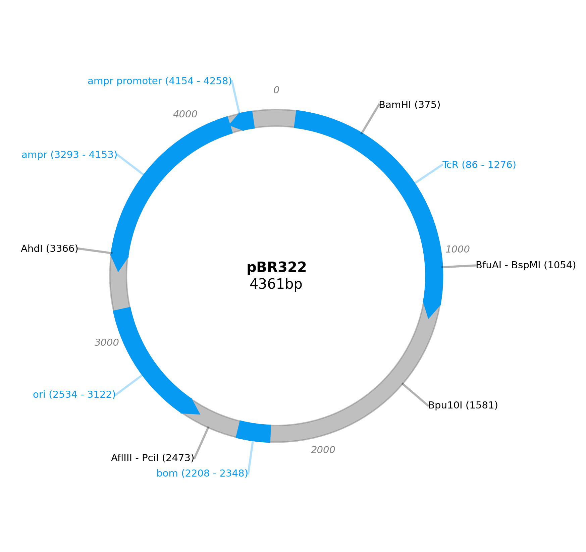
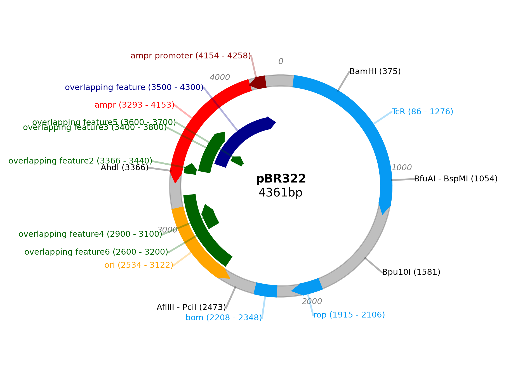
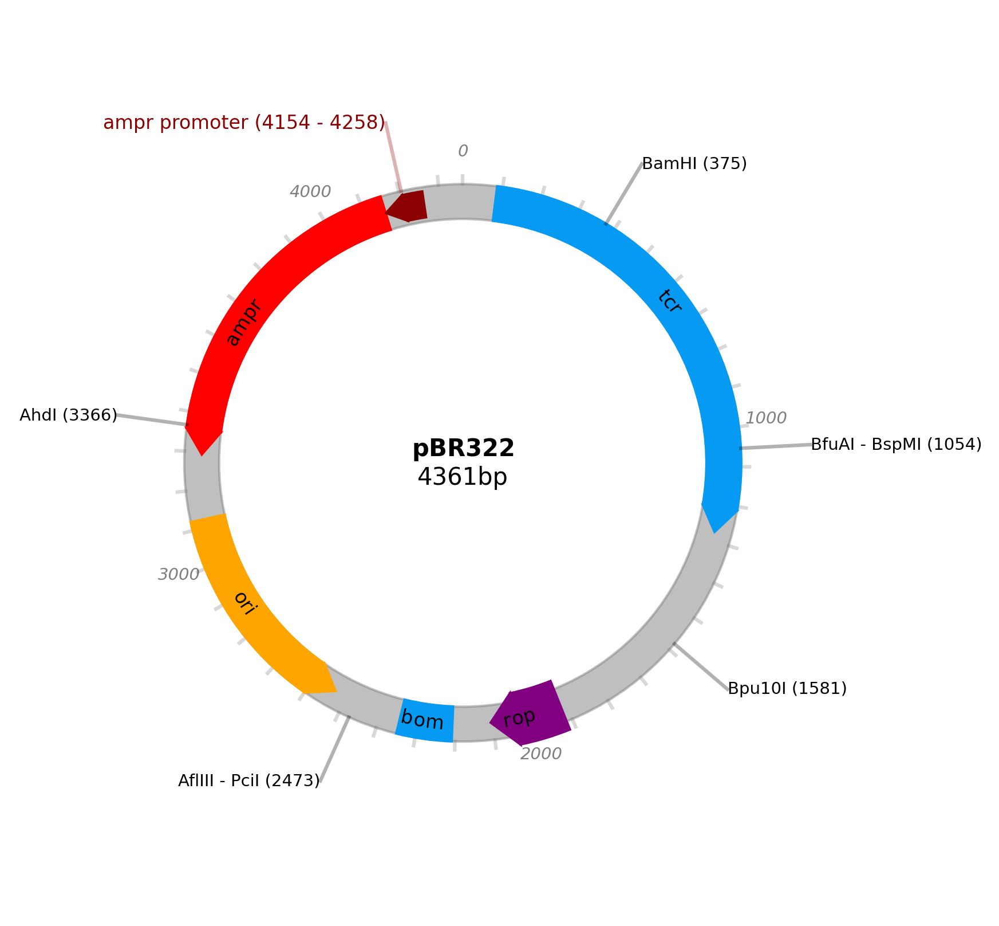

# plasmideasel - A simple Python plasmid map creator GUI

Installation, Usage and API referance, hosted on readthedocs [here](https://plasmideasel.readthedocs.io/en/latest/).

plasmideasel is a GUI based on plasmidcanvas, a Python graphics package designed for producing customised plasmid maps. 

**Top level overview of plasmideasel' current features as of v1.0.0**

* Directional arrows and rectangles to represent features of a plasmid.
* Support for restriction sites.
* Support for arbitrary labels.
* Support for overlapping features by automatically moving features inwards.
* Support for base pair "ticks".
* Support for genbank files.
* Support for save and reload.
* Select features shown
* Modify features
* Support for Default and Minimal styles
* Plasmids can be saved to a variety of filetypes e.g. png, pdf, ps, eps and svg.

Please cite figures generated by this software, citation can be found here: https://github.com/faulknerrainford/plasmideasel

# Examples

