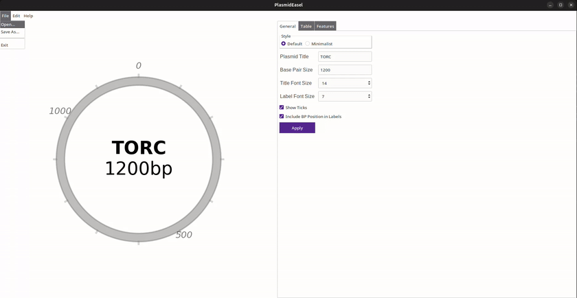
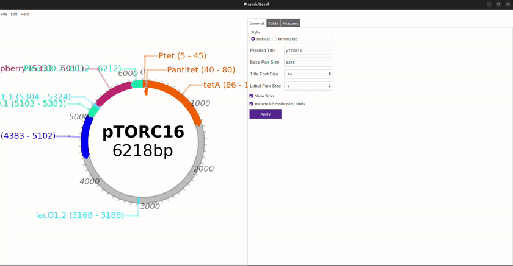
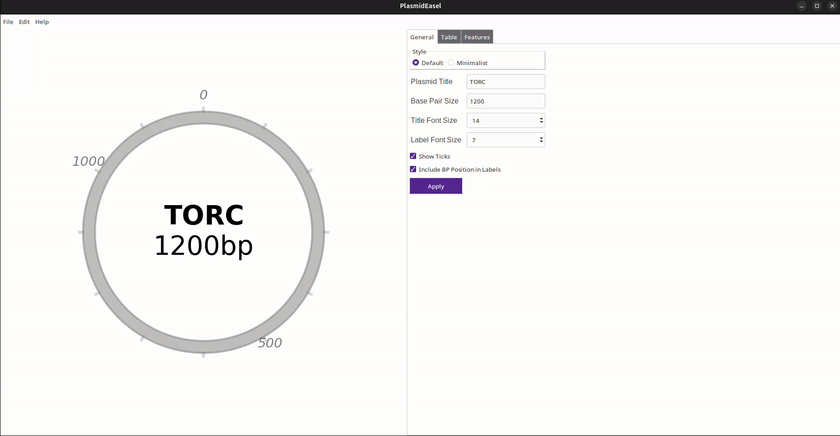
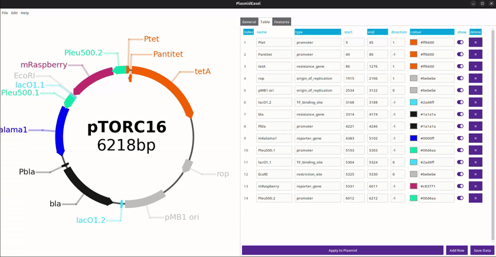
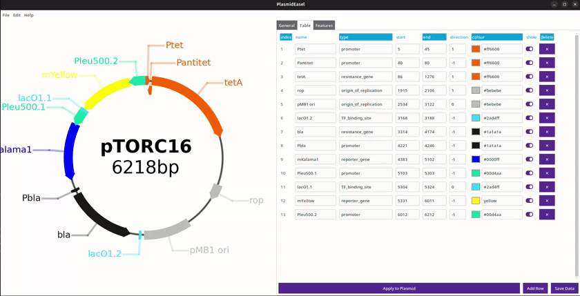
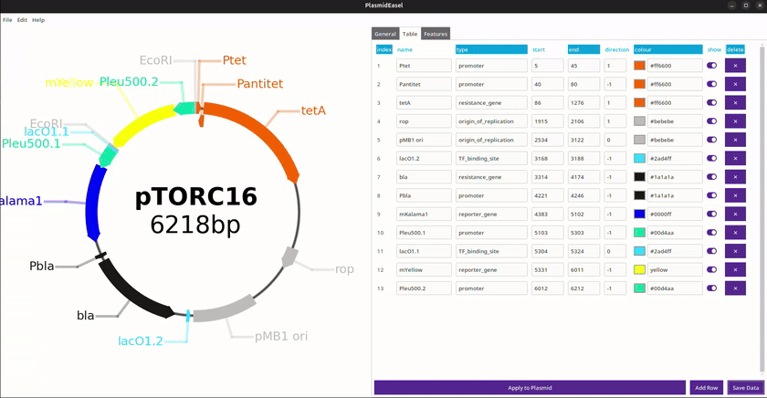

Tutorial
========

Starting - Opening files
------------------------

File -> Open... -> Select File -> Open

General Tab
-----------

Edit title or bp size then hit Apply to update figure.

Title font size modifies the combined title and BP size labels.
Label font size modifies the size of the feature labels

Ticks can be shown or removed, so can the base pairs on feature labels.

Two preset styles are provided:

Default - includes everything and uses a wide plasmid circle
Minimal - removes ticks and base pair labels, sets plasmid circle to a thinner black line

Table Tab
---------
Features can be added to the Table tab, even from a blank table.

Feature properties can be edited, plasmid will update when the "Apply to Plasmid" button is pushed.

Colour can be selected or set by name or hex code

Direction can be set (1 forward/clockwise, -1 backward/anticlockwise, 0 rectangular feature)

Toggle which features are showing.

Features can be deleted using the cross at the end of the row and new features can be added using "Add row". Both take effect after selecting apply.

Features Tab
------------

Feature tab can be used to select which types  of feature are shown, this toggles their show value in the table.

This is useful for working with genbank files which often have a large number of features. Types can be edited in the Table tab.

Saving Table
------------

The table of features (and title and size) can be saved as a csv file for reuse with "Save Data"

Saving Plasmid
--------------

The plasmid figure can be saved through the file menu: File -> Save...

The file can be saved as png, svg, pdf or jpeg. It saves with a tight box around the current displayed plasmid.

